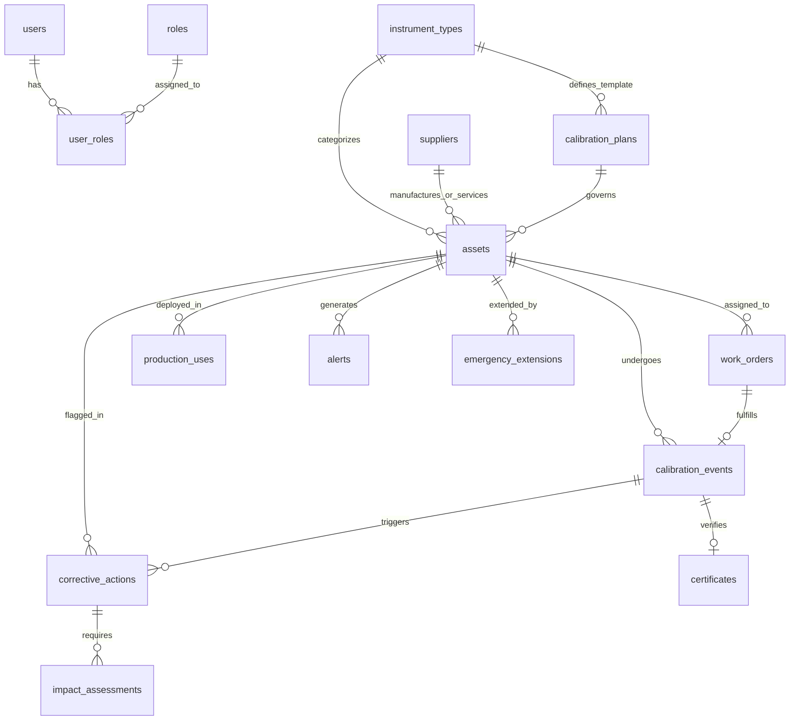

# CalibraFlow — Architecture & Technical Design

## 1. Relational Database Schema (MySQL 9.1)

CalibraFlow operates on 16 relational database tables with strict foreign-key integrity, cascade policies, and UTC timestamps:



### Table Specifications
1. **`users`**: User identities, bcrypt hashed passwords, active status.
2. **`roles`**: RBAC definitions (`Administrator`, `Quality Engineer`, `Maintenance Engineer`, `Plant Operator`, `Production Planner`).
3. **`user_roles`**: Many-to-many relationship mapping users to roles.
4. **`instrument_types`**: Metrological classifications (Pressure, Temperature, Torque, Flow, Weight, Voltage, Current).
5. **`suppliers`**: Accredited calibration vendor laboratories (e.g. Precisio Labs, NorthStar Metrology, Apex Cal Services).
6. **`assets`**: Physical instrument instances (`asset_code`, serial numbers, plant location, production line, last calibration date, next due date, operational status).
7. **`calibration_plans`**: Interval periodicity (e.g. 6 or 12 months), tolerance limits, error calculation formulas.
8. **`calibration_events`**: Recorded calibration test results, measured values, reference standards, percentage error, PASS/FAIL status.
9. **`certificates`**: Official calibration certificates (`certificate_code`, valid dates, issuing authority, verification status, file storage path).
10. **`work_orders`**: Maintenance job orders (`work_order_code`, priority, status, planned and actual downtime minutes).
11. **`production_uses`**: Real-time production line deployment attempts (`usage_code`, line, operator, decision: ALLOWED/FLAGGED/BLOCKED, explicit reasons).
12. **`alerts`**: System compliance alerts (`alert_code`, severity: CRITICAL/HIGH/MEDIUM/LOW, title, description, acknowledged status).
13. **`audit_records`**: Append-only immutable historical audit logs (`entity_type`, `entity_id`, actor, before/after JSON diffs).
14. **`corrective_actions`**: CAPA investigations for failed calibrations or non-compliances.
15. **`impact_assessments`**: Quality containment evaluations documenting production batches exposed to out-of-spec instruments.
16. **`emergency_extensions`**: Formal, QA-approved extension permits granting temporary grace periods for overdue instruments.

---

## 2. Frontend Component Hierarchy

The frontend is structured into modular, reusable React components:

```
src/
├── components/
│   ├── Layout.jsx              # Main App Shell (.app > .sb + .rt > .top + .mn)
│   ├── Sidebar.jsx             # CalibTrack clean white sidebar with 10 nav items & live engine widget
│   ├── Navbar.jsx              # Global search, notification bell, persona switcher, AI drawer trigger
│   ├── StatusBadge.jsx         # Uniform .tg status pills (green, yellow, red, blue)
│   └── AIAssistantDrawer.jsx   # Natural language analytics assistant drawer
├── context/
│   └── AuthContext.jsx         # JWT session management & fast persona switcher
├── pages/
│   ├── DashboardPage.jsx       # Screen 1: Dashboard
│   ├── WorkflowBoardPage.jsx   # Screen 2: Workflow board
│   ├── InstrumentsPage.jsx     # Screen 3: Master instruments
│   ├── PlansAndEventsPage.jsx  # Screen 4: Plans & execution events
│   ├── CertificatesPage.jsx    # Screen 5: Certificates & cross-asset matching
│   ├── WorkOrdersPage.jsx      # Screen 6: Work orders & downtime
│   ├── ProductionUsePage.jsx   # Screen 7: Live usage gate validator & log
│   ├── AlertsPage.jsx          # Screen 8: Alerts & anomaly management
│   ├── AuditTrailPage.jsx      # Screen 9: Immutable audit trail with JSON diffs
│   ├── DataQualityPage.jsx     # Screen 10: Ground-truth validation metrics
│   └── LoginPage.jsx           # Sign-in portal with 1-click demo logins
└── services/
    └── api.js                  # Axios client with JWT interceptor & 401 handling
```
